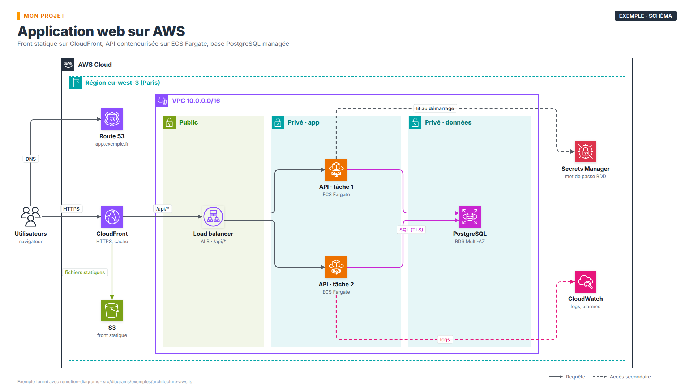
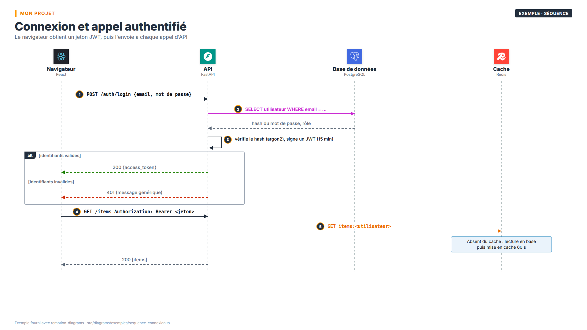

# remotion-diagrams

Des schémas d'architecture (AWS, C4, diagrammes de séquence) **décrits en TypeScript** et
rendus en **PNG** (image fixe) et en **MP4** (les éléments apparaissent étape par étape, des
paquets circulent sur les flèches) grâce à [Remotion](https://www.remotion.dev).

| Schéma d'architecture | Diagramme de séquence |
|---|---|
|  |  |

Un schéma = un objet TypeScript (nœuds, groupes, flèches, étapes). Pas d'outil de dessin :
le schéma se relit, se versionne et se modifie comme du code.

## Prérequis

- **Node.js ≥ 18** et npm
- Une connexion Internet au premier rendu : Remotion télécharge son propre Chrome headless
  (environ 100 Mo, gardé dans `node_modules/`)
- Sous Linux, les bibliothèques dont Chrome a besoin. Sur Debian ou Ubuntu, si le rendu échoue
  au lancement du navigateur :
  ```bash
  sudo apt install libnss3 libatk1.0-0 libatk-bridge2.0-0 libcups2 libxkbcommon0 \
    libxcomposite1 libxdamage1 libxrandr2 libgbm1 libpango-1.0-0 libasound2
  ```

## Installation

```bash
git clone <url-du-dépôt> remotion-diagrams
cd remotion-diagrams
npm ci
```

`npm ci` lance aussi `scripts/assets.mjs`, qui copie dans `public/` les ~800 icônes AWS
officielles (paquet `aws-icons`) et la police Inter. Ces fichiers sont générés et ne sont pas
versionnés. Si `public/aws/` est vide, relancer `node scripts/assets.mjs`.

## Utilisation

```bash
npm run studio          # aperçu interactif dans le navigateur (http://localhost:3000)
npm run list            # liste des schémas disponibles
npm run render          # tous les schémas, en PNG et en MP4, dans out/
npm run render:png      # PNG uniquement
npm run render:mp4      # MP4 uniquement
```

Options de `render.mjs` (après `--` avec npm, ou directement avec `node render.mjs`) :

| Option | Effet |
|---|---|
| `Exemple-1 C4` | ne rend que les schémas dont l'identifiant **commence** par l'un de ces préfixes |
| `--png` / `--mp4` | un seul format |
| `--scale=2` | résolution des PNG (défaut 2, soit 3840 × 2160 ; 1 = 1920 × 1080) |
| `--out=dossier` | dossier de sortie (défaut `out/`, avec `png/` et `mp4/` dedans) |
| `--concurrency=4` | nombre de rendus parallèles pour les MP4 (défaut : choisi par Remotion) |
| `--list` | affiche les identifiants et la durée de chaque schéma |

```bash
npm run render -- --png --scale=1 Exemple-1
node render.mjs --mp4 Exemple
```

Le PNG est la dernière image de l'animation, sans les paquets en mouvement ni les sous-titres.

Pour utiliser un Chrome déjà installé plutôt que celui que télécharge Remotion :
`REMOTION_BROWSER=/chemin/vers/chrome npm run render`.

## Créer ses propres schémas

### Organisation

```
src/
├── diagrams/
│   ├── exemples/          ← versionné : exemples à copier
│   │   ├── index.ts       ← export default [liste des schémas]
│   │   ├── architecture-aws.ts
│   │   └── sequence-connexion.ts
│   └── mon-projet/        ← vos schémas (ignoré par git)
│       ├── index.ts
│       └── ...
├── lib/                   ← le moteur (Diagram, Sequence, icônes, thème)
├── registry.ts            ← découverte automatique des dossiers de src/diagrams/
└── Root.tsx
```

Chaque fichier de `src/diagrams/` qui a un **`export default`** (un tableau de schémas) est
ajouté automatiquement : aucun fichier central à modifier. Dans le Studio, les schémas sont
rangés dans un dossier par projet. Les identifiants (`id`) doivent être uniques entre tous
les projets.

Seul `src/diagrams/exemples/` est versionné dans ce dépôt. Les autres dossiers de
`src/diagrams/` sont ignorés par git : vos schémas restent sur votre machine et ne
polluent pas l'outil. Pour les versionner, vous pouvez :
- faire de `src/diagrams/mon-projet/` un dépôt git à part (`git init` dans ce dossier) ;
- ou les copier dans le dépôt du projet documenté, avec les images rendues.

### Démarrer

```bash
cp -r src/diagrams/exemples src/diagrams/mon-projet
```

Puis, dans les fichiers copiés, changer les `id` (ils doivent rester uniques) et lancer
`npm run studio` : chaque enregistrement recharge l'aperçu.

```ts
// src/diagrams/mon-projet/index.ts
import {custom, diagram, Entry, sequence} from '../../lib/entries';
import {archi} from './archi';
import {login} from './login';

const entries: Entry[] = [diagram(archi), sequence(login)];
export default entries;
```

Trois types de schémas :

| Fonction | Rendu | Description |
|---|---|---|
| `diagram(spec)` | `DiagramSpec` | boîtes, groupes, flèches (AWS, C4, flux) |
| `sequence(spec)` | `SeqSpec` | diagramme de séquence (participants, messages, `alt` / `par`) |
| `custom(id, Composant, durée)` | composant React | schéma libre ; reçoit `still` (vrai pour le PNG), durée en frames |

### Le canevas

- 1920 × 1080 pixels, 30 images par seconde (`src/lib/theme.ts`).
- `x`, `y` d'un nœud = son **centre** ; `x`, `y` d'un groupe = son coin **haut gauche**.
- L'en-tête (marque, titre, sous-titre) occupe le haut jusqu'à y ≈ 150.
- **Étapes** : chaque élément a un `step`. Il apparaît à la frame `20 + step × stepFrames`
  (`stepFrames` = 20 par défaut, soit 0,67 s). Les décimales sont permises (`step: 1.5`).
  La durée de la vidéo est calculée automatiquement, plus `hold` frames de pause à la fin
  (180 par défaut).

### `DiagramSpec` (schéma d'architecture)

```ts
{
  id: 'Mon-Schema',              // nom du fichier rendu
  title: 'Titre', subtitle: '…', // en-tête
  brand: 'Mon produit',          // sur-titre orange (facultatif)
  tag: 'AWS · PROD',             // badge en haut à droite (facultatif)
  source: 'Source : …',          // pied de page (facultatif)
  stepFrames: 20, hold: 180,
  groups: [...], nodes: [...], edges: [...],
  notes: [...],                  // encadrés de texte
  legend: {x, y, step, items: [{color, text, dashed?}]},
  steps: {x, y, w, title, items: [{num, text}]},  // panneau d'étapes numérotées
  captions: [{step, text}],      // sous-titre affiché à partir de l'étape (vidéo seulement)
}
```

**Nœuds** (`nodes`) : `{id, x, y, step, title, tech?, desc?, icon?, kind?, w?, h?, size?, color?, external?, tag?}`

| `kind` | Aspect |
|---|---|
| `'card'` (défaut) | carte façon C4 : icône, titre, `tech` entre crochets, `desc` ; bord gauche de couleur `color` |
| `'icon'` | grande icône seule, titre et `tech` en dessous (style schéma AWS) ; `size` = taille de l'icône |
| `'chip'` | petite pastille (icône + titre), pour des éléments secondaires |

`external: true` dessine un système externe (gris, pointillés). `\n` dans un texte fait un
retour à la ligne.

**Groupes** (`groups`) : `{id, x, y, w, h, label, sub?, style, step, icon?}`. Styles :
`cloud`, `account`, `region`, `vpc`, `az`, `public`, `private`, `sg`, `ec2` (conventions des
schémas AWS), `c4` (frontière de système C4), `server`, `docker`, `github`, `generic`.

**Flèches** (`edges`) :

```ts
{
  from: ['api', 'right'],        // [id d'un nœud ou d'un groupe, côté, décalage px facultatif]
  to: ['db', 'left', 10],        // ou un point brut [x, y]
  step: 3,
  label: 'SQL', labelT: 0.5,     // position du libellé le long de la flèche (0 à 1)
  labelDx: 0, labelDy: -22,      // décalage du libellé
  num: 2,                        // pastille numérotée
  via: [[x, y], ...],            // points de passage imposés (sinon tracé en équerre automatique)
  mid: 800,                      // position du coude du tracé automatique
  color: C.database, dashed: true, width: 2,
  packets: 2,                    // paquets animés (0 = aucun)
  packetColor: C.database,
  both: true,                    // double sens
}
```

**Notes** (`notes`) : `{x, y, w, title?, lines: ['…'], step, tone?: 'info' | 'warn' | 'ok' | 'neutral', icon?}`.

### `SeqSpec` (diagramme de séquence)

```ts
{
  id, title, subtitle?, brand?, tag?, source?,
  participants: [{id: 'api', title: 'API', tech: 'FastAPI', icon: 'si:fastapi'}],
  items: [
    {kind: 'msg', from: 'nav', to: 'api', label: 'POST /login', num: 1},
    {kind: 'msg', from: 'api', to: 'nav', label: '200', reply: true},     // retour en pointillés
    {kind: 'self', on: 'api', label: 'vérifie le mot de passe'},          // appel sur soi-même
    {kind: 'note', over: ['api', 'db'], text: '…', tone: 'info'},         // info | warn | ok | err
    {kind: 'frame', label: 'alt', cond: 'si valide', over: ['nav', 'api']},
    {kind: 'else', cond: 'sinon'},
    {kind: 'end'},
  ],
  left: 150, right: 1770,        // abscisses du premier et du dernier participant
  top: 300, rowH: 50,            // ordonnée du premier message, hauteur d'une ligne
  stepFrames: 26, hold: 150,
  side: {x, y, w, title, lines}, // encadré latéral facultatif
  captions: [{step, text}],      // step = rang (à partir de 0) du message, self ou note
}
```

Les participants sont répartis à égale distance entre `left` et `right`.

### Icônes

Le nom d'une icône est préfixé par sa source :

| Préfixe | Source | Exemple |
|---|---|---|
| `aws:` | icônes officielles AWS : nom du fichier dans `public/aws/` sans `.svg` | `aws:AmazonRDS`, `aws:AWSLambda`, `aws:Users` |
| `si:` | [Simple Icons](https://simpleicons.org) : le *slug* de la marque | `si:github`, `si:postgresql`, `si:kubernetes` |
| `x:` | pictogrammes génériques fournis | `x:user`, `x:clock`, `x:gear`, `x:db`, `x:file`, `x:key`, `x:shield`, `x:bell`, `x:bolt`, `x:chart`, `x:rules`, `x:browser`, `x:sensor`, `x:queue`, `x:lake` |

Trouver une icône AWS : `ls public/aws | grep -i lambda`.

Une icône de marque est dessinée en tuile de la couleur officielle avec le pictogramme en
blanc, ou en sombre si la couleur est claire. Pour imposer d'autres couleurs, compléter
`BRAND_BG` et `BRAND_FG` dans `src/lib/icons.tsx`. Pour ajouter un pictogramme `x:`,
compléter `GLYPHS` dans le même fichier (tracés SVG sur une grille de 48 × 48).

### Couleurs

`import {C} from '../../lib/theme'` donne la palette : catégories AWS (`C.compute`,
`C.storage`, `C.database`, `C.network`, `C.security`, `C.mgmt`, `C.ml`), C4 (`C.c4person`,
`C.c4system`, `C.c4container`, `C.c4component`, `C.c4external`) et états (`C.ok`, `C.warn`,
`C.err`). Toute couleur CSS est aussi acceptée.

## Vérifier

```bash
npm run typecheck    # erreurs de types dans les schémas
```

Un identifiant de nœud inconnu dans une flèche ou une icône introuvable provoque une erreur
explicite dans le Studio ou au rendu.

## Licences

- Le code de ce dépôt n'a pas encore de licence : à préciser avant de le diffuser.
- **Remotion** est gratuit pour les particuliers, les associations et les entreprises de
  3 personnes au plus. Au-delà, une
  [licence entreprise](https://www.remotion.dev/license) est nécessaire.
- Icônes AWS : [AWS Architecture Icons](https://aws.amazon.com/architecture/icons/), via le
  paquet npm `aws-icons`. Icônes de marque : [Simple Icons](https://simpleicons.org) (CC0 ;
  les marques restent la propriété de leurs détenteurs). Police : Inter (SIL OFL).
